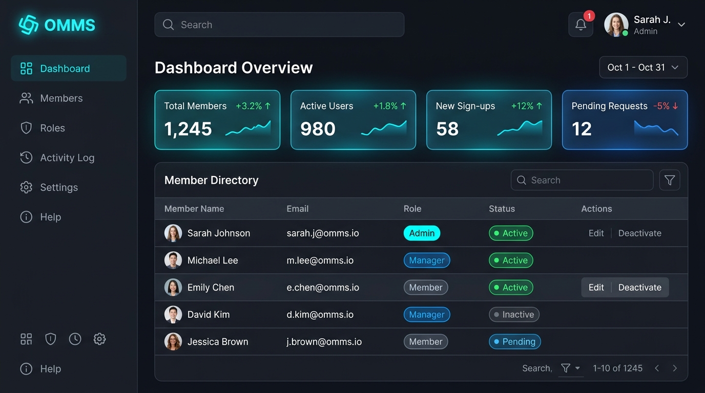
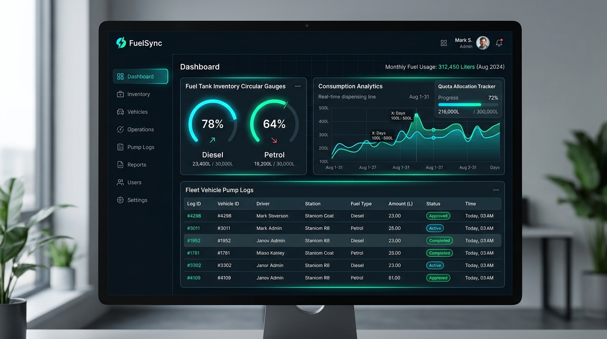
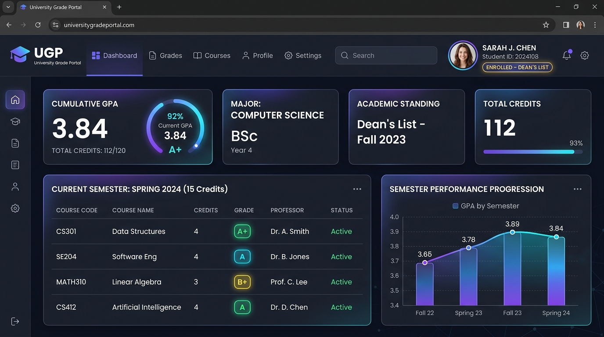
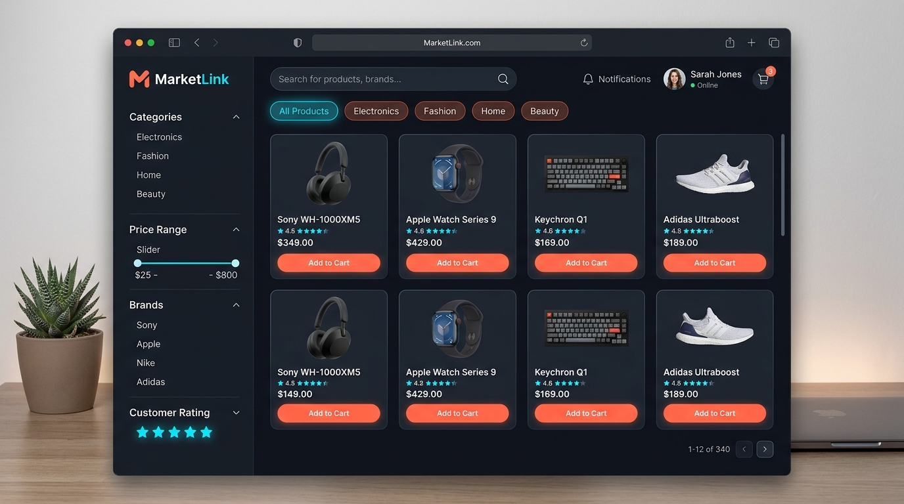

<!-- ===================== HEADER BANNER ===================== -->
<div align="center">



<br/>
<br/>

<a href="https://git.io/typing-svg">
  
</a>

<br/>


</div>

---

## 👨‍💻 About Me

<table>
<tr>
<td width="60%" valign="top">

I'm a **Full Stack Developer** dedicated to building **scalable, responsive, and production-ready web applications**. I specialize in modern JavaScript/TypeScript ecosystems, combining clean user interfaces with robust backend architectures and well-structured databases.

- 🎨 **Frontend**: Pixel-perfect, intuitive user interfaces with React, Next.js & Tailwind CSS
- ⚙️ **Backend**: Clean RESTful APIs, modular architectures, and scalable services with Node.js & Express
- 🗄️ **Databases**: Reliable data modeling and query optimization with MySQL, MongoDB & Prisma
- 🔐 **Security & Quality**: Secure authentication, role-based access control (RBAC), and maintainable code
- 🌍 **Location**: Based in **Ethiopia 🇪🇹**, available for remote work and global opportunities

</td>
<td width="40%" align="center" valign="middle">


<br/>

```js
const mitiku = {
  role: "Full Stack Developer",
  location: "Ethiopia 🇪🇹",
  focus: ["Next.js", "Node.js", "TypeScript", "SQL/NoSQL"],
  mindset: "Learn. Build. Optimize.",
  status: "Open to opportunities 🚀",
};
```

</td>
</tr>
</table>

---

## 🎯 Current Focus

| 🔭 Working On | 🌱 Learning & Mastering | 🤝 Open To |
|:---|:---|:---|
| Scalable full-stack SaaS applications with **Next.js** & **Node.js** | Advanced **TypeScript**, system architecture & cloud deployment | Full-time roles, freelance projects & open-source collaborations |

---

## 🛠️ Tech Stack

<div align="center">



</div>

<details>
<summary><b>📋 View Full Technology Badges</b></summary>
<br/>

<div align="center">

#### Languages & Frontend


#### Backend & Databases


#### Tools & DevOps


</div>
</details>

---

## 🚀 Featured Projects

<table>
<tr>
<td width="50%" valign="top">



### 🏢 Organization Member Management System (OMMS)
Comprehensive full-stack management platform engineered to automate organizational records, role delegations, administrative audits, and member directories.

* **Key Highlights**: Role-based access control (RBAC), structured relational schemas, and responsive administrative dashboards.
* **Tech Stack**: React, Node.js, Express, MySQL

<br/>

[](https://github.com/mitihans-1/member-management)
[](https://github.com/mitihans-1/member-management#live-demo)

</td>
<td width="50%" valign="top">



### ⛽ FuelSync
Smart fuel management solution designed to streamline fuel inventory, dispensing logs, quota allocations, and operational reporting.

* **Key Highlights**: Real-time tracking interface, robust data validation, automated quota alerts, and Prisma ORM schema migrations.
* **Tech Stack**: Next.js, TypeScript, Prisma, Tailwind CSS

<br/>

[](https://github.com/mitihans-1)
[](https://github.com/mitihans-1)

</td>
</tr>
<tr>
<td width="50%" valign="top">



### 🎓 University Grade Portal
Secure academic management portal providing self-service grade lookups for students and role-restricted result submission workflows for instructors.

* **Key Highlights**: JWT authentication, fine-grained access control, scalable MongoDB document models, and instant score aggregation.
* **Tech Stack**: React, Node.js, Express, MongoDB

<br/>

[](https://github.com/mitihans-1)
[](https://github.com/mitihans-1)

</td>
<td width="50%" valign="top">



### 🛒 MarketLink Marketplace
E-commerce platform connecting buyers and vendors with dynamic product catalogs, faceted search filtering, and seamless cart management.

* **Key Highlights**: Server-side rendering (SSR) for fast page loads, optimized search indices, modular cart state, and modern UI.
* **Tech Stack**: Next.js, Node.js, MongoDB, Tailwind CSS

<br/>

[](https://github.com/mitihans-1)
[](https://github.com/mitihans-1)

</td>
</tr>
</table>

---

## 📊 GitHub Statistics

<div align="center">


<br/>
<br/>


<br/>


</div>

---

## 💡 Core Strengths & Engineering Practices

| Focus Area | Engineering Capability |
|:---|:---|
| **Full-Stack Development** | Architecting end-to-end solutions from responsive UI layouts to backend business logic and database models |
| **API Engineering** | Building clean REST APIs with structured error handling, route validation, and standard HTTP conventions |
| **Data & ORM Modeling** | Designing relational (MySQL) and document (MongoDB) schemas using modern ORMs like Prisma |
| **Security & Auth** | Implementing authentication with JWT / Session tokens and strict Role-Based Access Control (RBAC) |
| **Code Quality** | Writing maintainable, modular, and readable code adhering to DRY and separation-of-concerns principles |

---

## 🌐 Connect & Collaborate

<div align="center">

[](mailto:mitikumitihans@gmail.com)
[](https://github.com/mitihans-1)
[](https://linkedin.com/in/)
[](https://t.me/)

</div>

---

<!-- ===================== FOOTER ===================== -->
<div align="center">

### 💬 *"Good software is built with clean code, clear thinking, and continuous learning."*

<br/>

⭐ **If you find my projects helpful or interesting, consider leaving a star!** ⭐


<sub>Designed & Built by <b>Mitiku Etafa</b> • Ethiopia 🇪🇹</sub>
</div>
